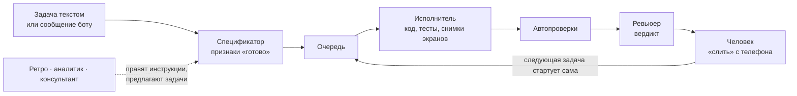
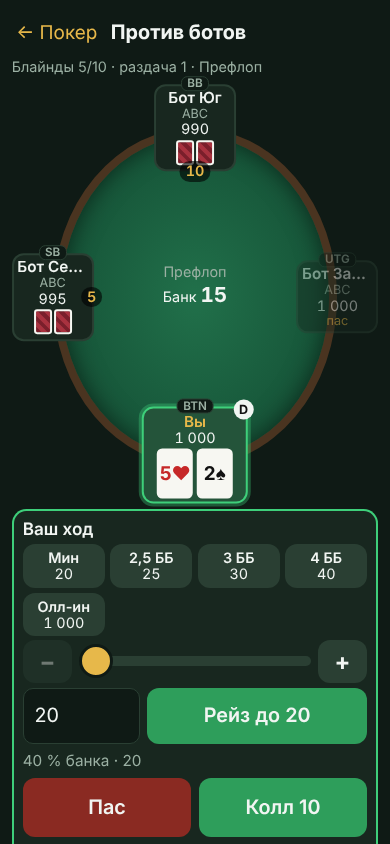
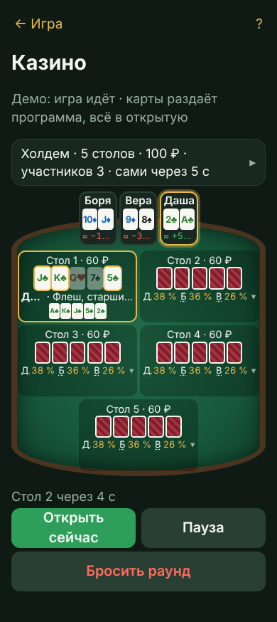
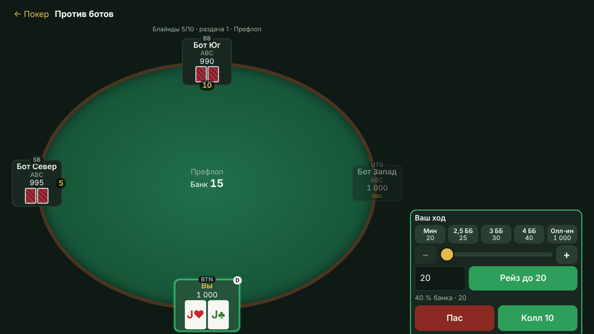

# Конвейер ИИ-агентов, который сам ведёт разработку

[English version](#ai-agent-pipeline-that-runs-software-development) · [Что построено](#что-построено-конвейером) · [Как устроен](#как-устроен-штаб) · [Цифры по неделям](#работа-конвейера-по-неделям) · [Беру заказы](#беру-заказы)

Строю и веду **«Штаб»** — конвейер агентов Claude, который ведёт цикл разработки без меня: задача текстом → агент-исполнитель пишет код и открывает PR → автопроверки → агент-ревьюер даёт вердикт → я сливаю с телефона. Моё участие — три вещи: ставлю задачи, принимаю решения, нажимаю «слить».

| 8 приложений | 230+ слитых PR агентов | ≈ 2 $ и 12 минут | 219 решений |
|:---:|:---:|:---:|:---:|
| на конвейере, два — с сервером | за шесть недель, с 01.10.2026 | обычная задача по медиане | каждая развилка записана с «почему так» |

Цифры на 13.11.2026. Доллары — не счёт, а оценка объёма работы: <a href="#откуда-доллары">откуда они</a>.

## Что построено конвейером

  
  &nbsp;&nbsp;
  

  

«Фишки»: стол против ботов на телефоне, казино на пять столов, тот же стол на компьютере. Снимки делает сам агент — они приходят в отчёте каждого PR «Фишек».

| Проект | Что это | Чем интересен |
|---|---|---|
| **Фишки** · [код](https://github.com/goigolden88/Magic_Fishki) · [открыть](https://goigolden88.github.io/Magic_Fishki/) | онлайн-покер с друзьями и учёт покерных вечеров: комната по ссылке, каждый на своём телефоне | первый проект целиком агентами, от пустого репо. Холдем, омаха, шорт-дек, турниры; боты шести стилей, которые подстраиваются под соперника; статистика и HUD, журнал раздач с выгрузкой, казино, версия для компьютера. Сервер — Cloudflare Workers, 850+ тестов |
| **ТоргСин** · [код](https://github.com/goigolden88/Torg_Sin) · [открыть](https://goigolden88.github.io/Torg_Sin/) | споры и ставки с друзьями «как Polymarket, только свой», без денег | каркас с сервером — за день; дальше этап за этапом: общий пул с коэффициентами, пари один на один, гарант, апелляция и суд присяжных жребием. Денежные правила проверены на злоупотребления до кода |
| **Семья local-first приложений:** [Делу Время](https://github.com/goigolden88/DeluVremya), [Дневники](https://github.com/goigolden88/Dnevniki), [Трапеза](https://github.com/goigolden88/Trapeza), [Злотые](https://github.com/goigolden88/Zloty), [Авто](https://github.com/goigolden88/Avto), [Тотальный Учёт](https://github.com/goigolden88/TotalUchet) | время, обслуживание и здоровье, еда, финансы, машина, сводка всего на одном экране | работают без сервера и сети (PWA), данные — на телефоне. Общее ядро [FamilyCore](https://github.com/goigolden88/FamilyCore): синхронизация через GitHub, новые версии ядра расходятся по приложениям сами; демо-режим без регистрации |

В работе: мини-игры «Потехе час» — рулетка, блэкджек и две игры своего замысла.

**Стек приложений:** Vite, React, TypeScript (strict), IndexedDB, Vitest, GitHub Pages, Cloudflare Workers (Durable Objects, SQLite).

## Как устроен «Штаб»

**Агенты на каждой задаче**

- **Спецификатор** — превращает просьбу в задачу: проверяемые признаки «готово», контекст для исполнителя со ссылками на код, оценка объёма.
- **Исполнитель** — берёт задачу из очереди, пишет код и тесты, открывает PR с отчётом; в «Фишках» и ТоргСине сам снимает экраны на ширине телефона и ноутбука. Класс задачи (простая, обычная, крупная) задаёт модель, усилие и предел ходов.
- **Ревьюер** — читает PR после зелёных проверок: «можно сливать» или «не сливать» с причинами и списком того, что проверить руками.
- **Развязчик** — сам разрешает конфликт, когда два PR задели одно место.

**Агенты по расписанию**

- **Ретро** — раз в неделю: сводка всех прогонов, ошибки агентов, правки их инструкций. Каждую правку сначала проверяет отдельный агент-«судья» без доводов автора.
- **Аналитик** — раз в неделю читает код и документы приложений и предлагает задачи; решает человек. Новых не предлагает, пока не разобраны прежние.
- **Консультант** — раз в месяц смотрит на всё сразу и предлагает до пяти изменений, у каждого доказательство (файл и строка) и цена.

**Что держит это в рамках**

- **Очередь** — задача «после #N» стартует сама, когда #N слита; суточный предел PR; стоп-кнопка.
- **Замер каждого прогона** — ходы, минуты и оценка в долларах; перед запуском пачки задач — прикидка, влезет ли она в лимиты подписки.
- **Решения до кода** — развилки разбираются с человеком заранее и записываются с причинами; облик выбирается на живых макетах, а не на словах.
- **Резерв** — раз в месяц копия всех репозиториев и задач; есть аварийный план на потерю аккаунта или сервиса и инструкция, как перенести конвейер на другую нейросеть.
- **Вход с телефона** — сообщение боту в Telegram → Cloudflare Worker → задача во входящих; сам конвейер ведётся из облачной сессии, с телефона или ноутбука.

Инструкции агентов и workflow открыты: **[Skills_Claude](https://github.com/goigolden88/Skills_Claude)** — с гайдом, как подключить агентов к своему репо.

**Стек конвейера:** Claude Code, GitHub Actions (`claude-code-action`), bash, Python, GitHub REST API, Cloudflare Workers, Telegram Bot API.

## Работа конвейера по неделям

По еженедельным отчётам ретро.

| Неделя | Что сделали агенты | PR агентов / слито | Ходов на прогон | Оценка, $ |
|---|---|---|---|---|
| 01–07.10 | первая неделя конвейера: функции «Делу Время» (особые дни, распорядок, итоги месяца), «Дневников», «Злотых»; подбор модели — одна задача двумя моделями, лучший PR сливался, 7 проигравших закрыты | 48 / 41 | 71 | — (замер с конца недели) |
| 08–12.10 | новое приложение «Фишки» от пустого репо; демо-режим в трёх приложениях — пачкой за вечер по образцу пилота | 25 / 24 | 71 | 52 |
| 13–14.10 | три задачи, все с первого раза | 3 / 3 | 52 | 3 |
| 15–21.10 | «Авто» с нуля — 15 слитых PR за неделю; справки и доработки остальных | 44 / 44 | 68 | 92 |
| 22–28.10 | онлайн-покер в «Фишках»: комната по ссылке, карты на телефонах, турниры, омаха и шорт-дек, стол против ботов | 35 / 35 | 88 | 101 |
| 29.10–04.11 | «Фишки»: история раздач, боты со стилями игры, шансы при ва-банке и в казино; новый проект ТоргСин — каркас с сервером за день и общий пул ставок | 48 / 48 | 73 | 69 (без ТоргСина) |
| 05–11.11 | «Фишки»: версия для компьютера, журнал раздач с выгрузкой, статистика, HUD, заметки об игроках; ТоргСин: пари с коэффициентом, апелляция и суд | 34 / 33 | 111 | 140 |

Задачи растут вместе с проектами: в последней неделе 21 задача из 34 — крупные, отсюда больше ходов и долларов при том же числе PR. Медиана по классам за четыре недели (161 прогон): простая — 0,84 $, обычная — 2,04 $, крупная — 4,11 $; ревью — 0,63 $.

> **Откуда доллары.** Конвейер работает по подписке Claude, отдельного счёта за задачу нет. Доллары — оценка самого Claude Code: после каждого прогона он считает, сколько стоили бы потраченные токены по ценам API (`total_cost_usd`), и конвейер пишет это в «Замер прогона» вместе с ходами и минутами. Это мера объёма работы — по ней сравниваются задачи, модели и недели.

## Что находили ретро, аналитик и консультант

- **72 отказа в правах за первую неделю → 0.** Исполнитель упирался в запреты на команды (`gh pr create`, перенаправление вывода, составные команды). Ретро переписало инструкцию — отчёт PR файлом, список разрешённых команд в промпте; со второй недели отказов 0–3 на неделю.
- **8 прогонов без PR из-за одного пробела в YAML.** Выражение `${{ … - 1 }}` в workflow очереди ломалось молча, разбор YAML этого не видел. Ретро добавило проверку `actionlint` на PR с workflow и доказало пробой: на старой ошибке проверка красная, после правки — зелёная.
- **Задачи оказывались больше своей оценки — две недели подряд, в четырёх проектах.** Ретро добавило спецификатору правило: сверять «Оценку» со слитым PR по тем же файлам. Промахов стало 2 из 30 вместо 9 из 35.
- **Двойной тап удваивал капитал.** Аналитик нашёл в «Злотых»: быстрый двойной тап по «Сохранить» записывал операцию дважды. Задача → PR → слито в тот же день; позже защита переехала в общее ядро и расходится по всем приложениям сама.
- **Пять дыр в денежных правилах — до первой строчки кода.** Перед этапом расчётов ТоргСина правила проверили на злоупотребления: отмена задним числом, «бесплатный выход» из спора и ещё три. Закрыты решениями до того, как агент начал писать расчёт.
- **«Проверь на телефоне» — оговорка, а не проверка.** Консультант нашёл дефекты, прошедшие ревью с этой фразой. Теперь в «Фишках» и ТоргСине исполнитель сам снимает экраны на нескольких ширинах и кладёт их в отчёт PR.
- **Одни тренировки вносятся в два приложения.** Консультант заметил, что «Дневники» и «Делу Время» просят одно и то же, и показал, где связь между ними уже решена, но не сделана.
- **Старт сессии — скрипт вместо ручной починки.** Консультант посчитал, что каждая облачная сессия тратила ходы на починку клонов, — теперь это делает `start.sh` одним вызовом.

## Беру заказы

Небольшие проекты на 1–5 дней: веб-приложения и PWA на React/TypeScript, Telegram-боты, скрипты и парсеры на Python, Cloudflare Workers — и настройка агентов Claude под ваш репозиторий.

Связаться: [goigolden88@gmail.com](mailto:goigolden88@gmail.com)

---

# AI agent pipeline that runs software development

I build and run **Shtab**, a pipeline of Claude agents that runs the development cycle on its own: a task in plain text → an executor agent writes code and opens a PR → automated checks → a reviewer agent gives a verdict → I merge from my phone. My part is three things: set tasks, make decisions, press "merge".

**Numbers (Nov 13, 2026):** 8 apps on the pipeline, two of them with a server · 230+ merged agent PRs in six weeks · a regular task is about $2 and 12 minutes by median · 219 recorded decisions, each with its "why".

> **Where the dollars come from.** The pipeline runs on a Claude subscription, so there is no per-task bill. The dollars are Claude Code's own estimate: after each run it reports what the tokens would cost at API prices (`total_cost_usd`), and the pipeline logs it with turns and minutes. It is a measure of work, used to compare tasks, models and weeks.

**Built by the pipeline**

- **[Fishki](https://github.com/goigolden88/Magic_Fishki)** ([open](https://goigolden88.github.io/Magic_Fishki/)) — online poker with friends and poker-night bookkeeping, built entirely by agents from an empty repo: rooms by link, Hold'em, Omaha, short deck, tournaments, bots in six playing styles that adapt to opponents, stats and HUD, hand log export, a desktop layout. Server on Cloudflare Workers, 850+ tests. Screenshots above are taken by the agent itself and arrive in its PR reports.
- **[TorgSin](https://github.com/goigolden88/Torg_Sin)** ([open](https://goigolden88.github.io/Torg_Sin/)) — friendly bets "like Polymarket, but your own", no real money: pooled events with odds, one-on-one bets, a guarantor, appeals and a jury drawn by lot. The skeleton with a server took one day.
- **A family of local-first PWAs** (time, journals, food, finance, car log, dashboard) on a shared core, [FamilyCore](https://github.com/goigolden88/FamilyCore): no server, data stays on the phone, sync through GitHub, core updates reach every app automatically.

**Agents:** specifier (turns a request into a task with testable acceptance criteria) · executor (code, tests, PR with screenshots where set up; task class sets model, effort and turn limit) · reviewer ("merge" / "don't merge" with reasons and manual checks) · resolver (merge conflicts) · weekly retro (reviews every run, fixes agent instructions; each fix is checked first by a separate "judge" agent) · weekly analyst (proposes tasks) · monthly consultant (up to five process changes, each with evidence and cost).

**Guardrails:** a queue where the next task starts when the previous one is merged, daily PR limits and a stop switch · every run measured in turns, minutes and dollars, with a budget estimate before each batch · decisions made and written down before code · monthly backups, a disaster plan and a guide for moving the pipeline to another AI model · tasks from the phone via a Telegram bot and a Cloudflare Worker.

**Week by week** (from retro reports; $ = executor `total_cost_usd`):

| Week | What agents built | Agent PRs / merged | Turns per run | Estimate, $ |
|---|---|---|---|---|
| Oct 1–7 | first week: features in time-tracking, journals and finance apps; model selection by running one task on two models | 48 / 41 | 71 | — |
| Oct 8–12 | a new app from an empty repo; demo mode in three apps in one evening | 25 / 24 | 71 | 52 |
| Oct 13–14 | three tasks, all first try | 3 / 3 | 52 | 3 |
| Oct 15–21 | a car-log app from scratch — 15 merged PRs in a week | 44 / 44 | 68 | 92 |
| Oct 22–28 | online poker: rooms by link, cards on phones, tournaments, Omaha and short deck, bots | 35 / 35 | 88 | 101 |
| Oct 29 – Nov 4 | poker: hand history, bots with playing styles, all-in odds; a new betting app — skeleton with a server in a day, pooled events | 48 / 48 | 73 | 69 (excluding the new app) |
| Nov 5–11 | poker: desktop layout, hand log export, stats, HUD, player notes; betting app: bets with odds, appeals and jury | 34 / 33 | 111 | 140 |

**What retro, analyst and consultant found:** 72 permission denials in week one dropped to 0–3 a week after the retro rewrote the executor's instructions · 8 runs without a PR traced to one space in a YAML expression — the retro added `actionlint` and proved it red on the old bug · tasks were bigger than their estimates two weeks running — the specifier now checks estimates against the last merged PR on the same files, and misses fell from 9 of 35 to 2 of 30 · the analyst found that a fast double tap saved a finance entry twice; the fix later moved into the shared core · five loopholes in the betting app's money rules were found and closed before any settlement code was written · the consultant noticed that "check on your phone" in reviews was a caveat, not a check — in the two largest apps the executor now attaches screenshots at several widths to its PRs.

Agent instructions and workflows are open: [Skills_Claude](https://github.com/goigolden88/Skills_Claude).

**Open to small projects (1–5 days):** React/TypeScript web apps and PWAs, Telegram bots, Python scripts and scrapers, Cloudflare Workers, Claude agent setup for your repo. Contact: [goigolden88@gmail.com](mailto:goigolden88@gmail.com)
